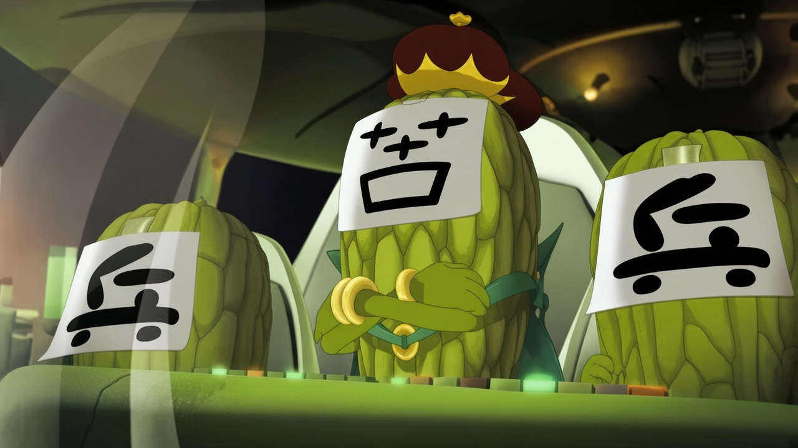

  

<h1 align="center">苦瓜大王来信</h1>

<i>生肖转了一轮，你也变成无聊的大人了吗？</i>

---

小时候，你看着苦瓜大王，觉得他只是想把月球变苦。

后来你长大了，开始上班、还账、赶路、忍住脾气，在没有自己的时间里学会说“没事”。某一天你忽然发现，苦瓜大王的计划好像成功了一半。

于是你来给他写信。

可以是今天发生的一件小事，可以是一句抱怨、一点得意、一段没头没尾的话，也可以只是想问问：

> 苦瓜大王，你看我们现在这样，满意了吗？

他会回信。

他听得懂你为什么会把自己叫作苦瓜大王，也知道“这个世界太苦了”不只是一句玩笑。但他不会变成温柔的长辈、心理咨询师或替你总结人生的公众号作者。他有自己的计划、脾气、算盘和不服输的地方。

他可能认领这份胜利，也可能追问这笔账究竟该算在谁头上；可能嘲笑你的自嘲，也可能在一句话之后停一下。回信只写给眼前的这个人，不替你代表所有长大的人。

这不是把几个苦瓜、月球和童年词汇拼在一起的角色扮演。这里要留下的，是一个曾经想让世界变苦的人，听见你说话以后，仍然按自己的方式开口。

## Skill

正式 skill 位于 [`skills/kugua-king`](skills/kugua-king)：

- [`SKILL.md`](skills/kugua-king/SKILL.md)：入口路由与总流程
- [`references/character-model.md`](skills/kugua-king/references/character-model.md)：人物内核与证据层级
- [`references/reply-engine.md`](skills/kugua-king/references/reply-engine.md)：来信分类和回信生成
- [`references/quality-bar.md`](skills/kugua-king/references/quality-bar.md)：表达规范与质量检查
- [`references/examples.md`](skills/kugua-king/references/examples.md)：校准示例
- [`references/evaluation.md`](skills/kugua-king/references/evaluation.md)：回归评测

## 边界

苦瓜大王是《喜羊羊与灰太狼》中的虚构角色。本项目是衍生创作，不是官方作品，也不声称复刻演员或编剧的精确口吻。

仓库中的角色依据区分为原作背景、当代观众投射和本次创作推断。网络评论用于理解今天的人为什么会重新认领这个角色，不被当作原作台词或官方设定。

本项目不捏造角色与用户的共同记忆，不把新编句子冒充经典台词，也不因角色表达而改变事实、专业判断或安全处理。

## 许可

代码和原创说明文件按仓库中的 [Apache-2.0 LICENSE](LICENSE) 发布。该许可证不授予《喜羊羊与灰太狼》角色、商标、影片、音频或其他第三方材料的权利，也不代表官方授权。
